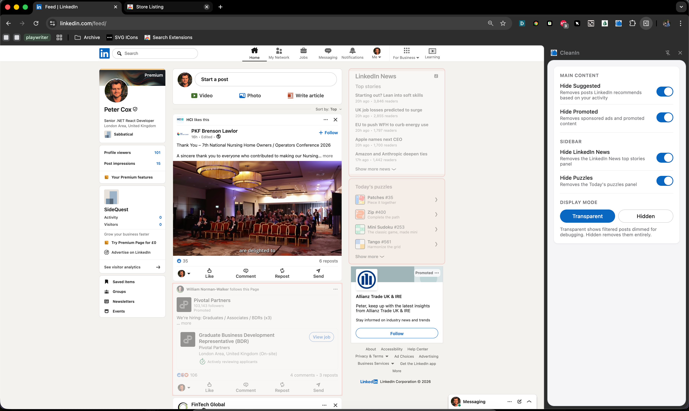

<h2> CleanIn</h2>

CleanIn is a simple Chrome extension that hides unwanted feed content masquerading as real content, such as:

1. Suggested posts
2. Promoted and Promoted by posts
3. Sidebar content like News and Puzzles

They are hidden by default, but you can show them as transparent in the General settings if you prefer (dimmed on the page instead of removed).

The source code is available if you'd prefer to build it yourself: [https://github.com/PeterWCox/CleanIn](https://github.com/PeterWCox/CleanIn). I'm open to adding additional functionality—feel free to e-mail me.

## Docs & store releases

- Chrome Web Store form copy and justifications: [docs/chrome-web-store-privacy-answers.md](docs/chrome-web-store-privacy-answers.md) (see also [docs/README.md](docs/README.md)).
- Release TLDR:
  1. Create a `VX.Y.Z` release branch, for example `V1.5.0`, and bump `public/manifest.json` on that branch.
  2. Push the branch to start Azure. `main` does not trigger builds.
  3. Azure installs dependencies, runs the tests and typecheck, builds the extension, validates that the generated manifest version matches the branch name, validates the extension files, and publishes the `cleanin-chrome-store-v*.zip` artifact in `Build Dist`.
  4. In the `Upload to Chrome Store` manual stage, download the artifact, upload it to the Chrome Developer Store, and resume the pipeline.
  5. Release the uploaded package through the Chrome Web Store, then merge the release branch into `main` after production testing.

## Developer instructions

1. Clone this repo.
2. Optional: [snippets/](snippets/) has small reference HTML files for the feed and sidebar shapes the content script looks for.
3. Run `pnpm install --frozen-lockfile`, `pnpm test`, `pnpm run typecheck`, and `pnpm run build`.
4. Open `chrome://extensions` in Chrome.
5. Toggle Developer mode on (top right).
6. Click Load unpacked and select `/Users/petercox/Downloads/extensions/cleanin-dev` (the default local build output).
7. Visit [linkedin.com](https://www.linkedin.com/) or [linkedin.com/feed](https://www.linkedin.com/feed/) and click the CleanIn toolbar icon to adjust filters in the settings popup.

`public/` contains the static extension files, assets, and manifest. The React popup lives in `src/popup/` and is bundled into the build output. `pnpm run dev` serves a preview at [http://127.0.0.1:11016/popup/popup.html](http://127.0.0.1:11016/popup/popup.html); `pnpm run storybook` starts Storybook at [http://localhost:16016](http://localhost:16016). The `tmux-dev.sh` script manages the `cleanin-dev` tmux session. Local builds display a Beta badge and keep manifest version `1.5.2` unchanged. Azure builds the production extension into the pipeline artifact staging directory; the manual store upload/release gate remains the final stage.

## Regression checks

Use Node.js 24 or later. `pnpm test` runs the background and popup tests, and
`pnpm run typecheck` checks types. `pnpm run test:stories` runs the popup stories in headless Chromium, and `pnpm run build-storybook` verifies the review build. `pnpm run build` creates the unpacked extension
in `/Users/petercox/Downloads/extensions/cleanin-dev` by default.

## Caveats
- Only matches the English LinkedIn UI. If your LinkedIn is in French, *toutes mes excuses*.
- LinkedIn could rename "Suggested" to "Things You'll Love" tomorrow and break everything. That's the deal you sign when you scrape a SPA.
- Does not, sadly, hide posts that begin with "Unpopular opinion:".

## License
- MIT. Use it, fork it, ship a better version. Just don't promote it on LinkedIn.

## Backups

Settings includes shared **Backup and restore** controls for all seven saved preferences, including both legacy promoted flags and transparent mode. Import requires confirmation and preserves preferences omitted by a partial backup. Failed restores can be retried.

All extensions use `@petercoxhatesbridges/extension-ui@0.2.3` and pnpm 12.15.0. The versioned backup format rejects files belonging to another extension. Development and store builds of the same extension can exchange backups.
