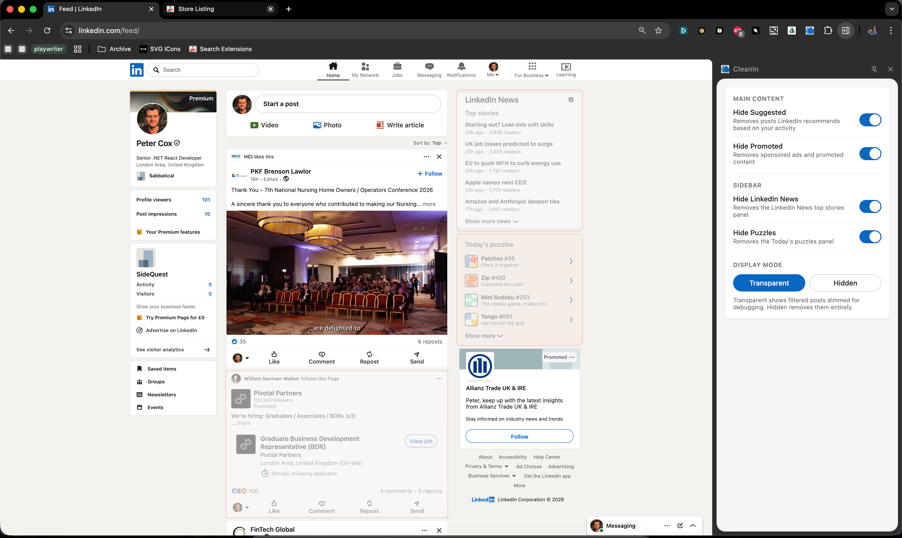

<h2> CleanIn</h2>

CleanIn is a simple Chrome extension that hides unwanted feed content masquerading as real content, such as:

1. Suggested posts
2. Promoted and Promoted by posts
3. Sidebar content like News and Puzzles

Choose Show, Fade or Hide for each filter. You can also control photo and video attachments, and back up or restore your preferences. Existing preferences carry over when updating.

The source code is available if you'd prefer to build it yourself: [https://github.com/PeterWCox/CleanIn](https://github.com/PeterWCox/CleanIn). I'm open to adding additional functionality—feel free to e-mail me.

## Docs & store releases

- Chrome Web Store listing copy, permission justifications and version history: [CHROMEWEBSTORE.md](CHROMEWEBSTORE.md).
- The [GitHub Actions build](https://github.com/PeterWCox/CleanIn/actions/workflows/release.yml) runs on pushes to `codex/dev` and `main`, on pull requests to those branches, or when started manually.
- Make and test changes on `codex/dev`, then merge into `main` for release. Keep the version in `public/manifest.json` and `package.json` in sync. The workflow checks both versions before packaging.
- Download `cleanin-chrome-store-v*.zip` from the successful `main` run and upload it through the Chrome Web Store Developer Dashboard.

## Developer instructions

1. Clone this repo.
2. Optional: [snippets/](snippets/) has small reference HTML files for the feed and sidebar shapes the content script looks for.
3. Run `pnpm install --frozen-lockfile`, `pnpm test`, `pnpm run typecheck`, and `pnpm run build`.
4. Open `chrome://extensions` in Chrome.
5. Toggle Developer mode on (top right).
6. Click Load unpacked and select `/Users/petercox/Downloads/extensions/cleanin-dev` (the default local build output).
7. Visit [linkedin.com](https://www.linkedin.com/) or [linkedin.com/feed](https://www.linkedin.com/feed/) and click the CleanIn toolbar icon to adjust filters in the settings popup.

`public/` contains the static extension files, assets, and manifest. The React popup lives in `src/popup/` and is bundled into the build output. `pnpm run dev` serves a preview at [http://127.0.0.1:11016/popup/popup.html](http://127.0.0.1:11016/popup/popup.html); `pnpm run storybook` starts Storybook at [http://localhost:16016](http://localhost:16016). The `tmux-dev.sh` script manages the `cleanin-dev` tmux session. Local builds display a Beta badge and use the version from `public/manifest.json`. Run `pnpm run dev:extension` to watch the popup, manifest, and content scripts. After the first build, load or reload the unpacked CleanIn entry once in `chrome://extensions`. Subsequent successful builds reload the extension and refresh open LinkedIn feed tabs automatically while the watcher is running.

## Regression checks

Use Node.js 24 or later, pnpm 12.15.0, and [Bun 1.4.4](https://bun.com/docs/installation). `pnpm test` runs the background tests with Bun and the popup tests with Vitest, and
`pnpm run typecheck` checks types. `pnpm run test:stories` runs the popup stories in headless Chromium, and `pnpm run build-storybook` verifies the review build. `pnpm run build` creates the unpacked extension
in `/Users/petercox/Downloads/extensions/cleanin-dev` by default.

## Caveats
- Only matches the English LinkedIn UI. If your LinkedIn is in French, *toutes mes excuses*.
- LinkedIn could rename "Suggested" to "Things You'll Love" tomorrow and break everything. That's the deal you sign when you scrape a SPA.
- Does not, sadly, hide posts that begin with "Unpopular opinion:".

## License
- MIT. Use it, fork it, ship a better version. Just don't promote it on LinkedIn.

## Backups

Settings includes shared **Backup and restore** controls for saved preferences, including per-filter Show/Fade/Hide choices and legacy promoted flags and transparent mode. Import requires confirmation and preserves preferences omitted by a partial backup. Failed restores can be retried.

CleanIn uses the vendored `@petercoxhatesbridges/extension-ui@0.2.16` package and pnpm 12.15.0. The versioned backup format rejects files belonging to another extension. Development and store builds of the same extension can exchange backups.
